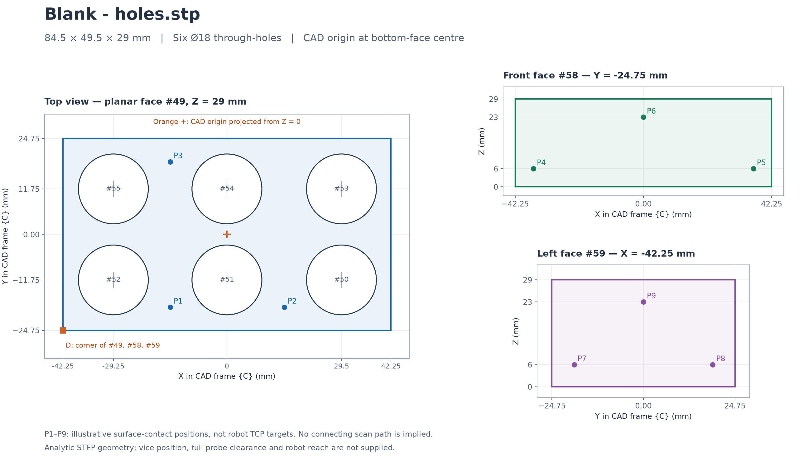

# Workpiece reference: inspection of Blank - holes.stp

This is step 2 of the workpiece-reference study, following
[the project baseline](WORKPIECE_REFERENCE_BASELINE.md). It records the supplied computer-aided
design (CAD) geometry and the measurements that could locate its planar datums. It does not
choose an industrial probing procedure or generate robot motion.

## Source and inspection method

- Source: the user-provided `Blank - holes.stp`, 16076 bytes, inspected on 2026-11-17.
- SHA-256: `db49a01e83947ba21931dbbb60fa128383e5e9b755d7d07793de373b522edcd4`.
- Format: STEP AP242, exported by C3D Converter / C3D Toolkit.
- Length unit: millimetres, entity #9. Plane-angle unit: radians, entity #11.
- Representation uncertainty: 0.00001 mm, entity #10. This is a CAD representation value;
  it supplies neither a manufacturing tolerance nor a probing accuracy requirement.

All STEP text was read. An independent inspection and numerical extraction agreed on the
planes, cylinders, boundaries and coordinate placement. The extraction found 399 entities,
resolved every entity reference, checked all 30 edge loops for coincident successive endpoints, and found that each
of the 24 edges has two face uses with opposite edge orientation. These are checks of the STEP
definitions, not a CAD-kernel validity check. No Open CASCADE import, build or robot operation
was performed. The supplied file was not changed.

Entity numbers below identify this exact file. A later CAD export can renumber the entities.
Terms such as top, front and left refer only to the CAD axes defined below, not to gravity,
the robot base or the eventual vice position.

## Coordinate system and shape

Let {C} denote the coordinate system of the exported CAD geometry. X, Y and Z below are point
coordinates in {C}, in mm. The shape placement #4 has origin (0, 0, 0), positive Z axis and
positive X reference direction. The boundary-representation solid #13 uses the same context
through representation #24 and relationship #25. No assembly transform or mapped placement
occurs in the file.

The shape is one rectangular block with six cylindrical through-holes:

| Quantity | CAD value |
| --- | --- |
| X extent | -42.25 to 42.25 mm |
| Y extent | -24.75 to 24.75 mm |
| Z extent | 0 to 29 mm |
| Outer dimensions | 84.5 × 49.5 × 29 mm |
| Solid and shell | One solid #13, one declared closed shell #14 |
| Faces | Six planes and six cylindrical hole walls; 12 faces total |
| Hole size and direction | All Ø18 mm, through the 29 mm thickness, axes parallel to Z |
| Hole rims | Twelve complete circles of radius 9 mm |

There are no chamfers or fillets in this model. Each hole axis is perpendicular to both end
planes, so the end edges are circles in three-dimensional geometry. A rigid placement of the
whole workpiece in the scene preserves that relationship; an oblique view can make the circles
look elliptical on the screen.

The CAD origin is the centre of the bottom rectangular footprint, on Z=0. There are no physical
faces on X=0 or Y=0. The negative-X reference directions in the local placements of some
surfaces define their parameter coordinates; they do not rotate the workpiece coordinate system.

Tiny export terms, approximately 1e-15 mm in some coordinates and 1e-16 in some direction
components, are shown as zero in the tables. The numerical extraction retained those terms.

## Planar faces available as geometric datum candidates

An outward direction points from the solid into the surrounding space. The table lists axis
directions, not robot approach commands. The normal of bottom face #48 is reversed by that
face's `same_sense=.F.`; the remaining planar faces use `same_sense=.T.`.

| Face | Supporting surface | Nominal plane | Outward direction | Finite face |
| --- | --- | --- | --- | --- |
| #48 | #74 | Z = 0 mm | Negative Z | 84.5 × 49.5 mm rectangle with six circular openings |
| #49 | #93 | Z = 29 mm | Positive Z | 84.5 × 49.5 mm rectangle with six circular openings |
| #56 | #154 | Y = 24.75 mm | Positive Y | 84.5 × 29 mm rectangle |
| #57 | #161 | X = 42.25 mm | Positive X | 49.5 × 29 mm rectangle |
| #58 | #168 | Y = -24.75 mm | Negative Y | 84.5 × 29 mm rectangle |
| #59 | #175 | X = -42.25 mm | Negative X | 49.5 × 29 mm rectangle |

The face bounds, not just the infinite supporting planes, determine where CAD material exists.
For either end face, a point must be inside the outer rectangle and outside the six circular
openings. None of the side faces contains an opening in this model.

## Hole positions and remaining material

The table gives the constant X and Y coordinates of each hole axis. Every axis runs between
Z=0 and Z=29 mm, and every radius is 9 mm.

| Cylindrical face | Surface | Axis X (mm) | Axis Y (mm) | Bottom circle | Top circle |
| --- | --- | ---: | ---: | --- | --- |
| #50 | #102 | 29.5 | -11.75 | #271 | #291 |
| #51 | #111 | 0 | -11.75 | #269 | #289 |
| #52 | #120 | -29.25 | -11.75 | #267 | #287 |
| #53 | #129 | 29.5 | 11.75 | #265 | #285 |
| #54 | #138 | 0 | 11.75 | #263 | #283 |
| #55 | #147 | -29.25 | 11.75 | #261 | #281 |

The hole pattern is not exactly symmetric in X: the columns are -29.25, 0 and 29.5 mm.
Calculated material widths between the hole rims and neighbouring boundaries are:

| Region | Calculation in mm | Width |
| --- | --- | ---: |
| Left outer rim | 42.25 - 29.25 - 9 | 4 mm |
| Right outer rim | 42.25 - 29.5 - 9 | 3.75 mm |
| Either Y outer rim | 24.75 - 11.75 - 9 | 4 mm |
| Between hole rows | 23.5 - 18 | 5.5 mm |
| Between left and middle columns | 29.25 - 18 | 11.25 mm |
| Between middle and right columns | 29.5 - 18 | 11.5 mm |

In particular, the interior strip -2.75 < Y < 2.75 mm contains no hole over the whole interior
width of either end face. Other patches exist between the columns. A CAD material patch can
still be inaccessible after clamping or for a particular probe orientation.

Subtracting six circles from the outer rectangle gives 2655.935970 mm² of material on each end
face: 84.5 × 49.5 minus 6 × pi × 9². Multiplying by the 29 mm thickness gives a nominal solid
volume of 77022.143140 mm³. These are calculations from the exported geometry, not measurements
of the physical workpiece.

## A plane triple and the CAD origin

One plane from each of the X, Y and Z pairs has three independent normal directions. There
are 2 × 2 × 2 = 8 such exterior-plane triples in this model. Their intersections are the eight
box corners. None of those intersections is the CAD origin.

For a concrete geometric example, select top #49, front #58 and left #59. Their intersection
has CAD coordinates (-42.25, -24.75, 29) mm. Call that point D and define a temporary frame {D}
with origin D and axes parallel to {C}. Positive Z follows the top face's outward direction;
positive X and positive Y oppose the outward directions of the left and front faces.

From D, the CAD origin lies 42.25 mm along positive X, 24.75 mm along positive Y and 29 mm along
negative Z. The transform matrix from {C} to {D}, with translations in mm, is therefore:

$$
{}^{D}A_C =
\begin{bmatrix}
1 & 0 & 0 & 42.25 \\
0 & 1 & 0 & 24.75 \\
0 & 0 & 1 & -29 \\
0 & 0 & 0 & 1
\end{bmatrix}
$$

The matrix sends the CAD coordinates of D to (0, 0, 0) in {D}, and sends the CAD origin to
(42.25, 24.75, -29) mm in {D}. This explicitly distinguishes a datum-corner origin from the
origin required to keep the CAD file's coordinates unchanged.

For rough measurements, let {D_R} be the corresponding measured corner frame, and let {B} be
the robot base frame. If {W_R} must retain the CAD origin and axes, its transform matrix is
obtained by composing the measured corner transform with the fixed CAD-origin offset:

$$
{}^{B}A_{W_R} = {}^{B}A_{D_R}\,{}^{D_R}A_{W_R}
$$

Here the second transform matrix has the numerical entries of the preceding matrix. The first
transform matrix must come from workpiece measurements; it is not present in the STEP file.
The same relationship applies to refined measurements. A rule for constructing perpendicular
unit axis directions from imperfectly perpendicular measured planes and a choice of datum priority remain
research questions; the ideal CAD calculation above does not select those rules.

These offsets use nominal CAD dimensions. Locating from the top and placing the origin 29 mm
below it aligns the selected top datum with CAD; it does not measure the physical bottom.
For example, if the actual thickness were hypothetically 29.2 mm, subtracting the nominal
29 mm from the actual top would put the constructed origin 0.2 mm above the actual bottom.
Likewise, an offset of half the nominal width from one side need not locate the actual centre
between two measured sides.

An alternative construction in the ideal CAD is to obtain X=0 and Y=0 from the opposing side
pairs, then combine those constructed midplanes with bottom Z=0. This uses five physical
planes. X=0 and Y=0 remain constructed planes, not surfaces that the probe can touch. Applying
this alternative to nonparallel measured sides would also require an explicit fitting rule.

## Illustrative measurements for the selected triple

The existing `Plane::fromPoints` needs at least three finite readings that are not all on one
straight line per
independently fitted plane (`src/geometry/plane.cpp:8-35`). Thus fitting all three planes
independently with that operation needs at least nine readings. This count describes that
specific fitter; it does not select the contact count or order for a future datum-construction procedure.

P1 through P9 below are illustrative physical surface positions in {C}, in mm. They are not
positions stored in the STEP file, measured points, robot-base coordinates or tool centre point
(TCP) targets. An illustrative 6 mm inset was selected to show separated points inside the
face boundaries. This inset is not an accepted robot or probe clearance.

For the top face, X positions are the midpoints between neighbouring hole columns:
(-29.25 + 0)/2 = -14.625 mm and (0 + 29.5)/2 = 14.75 mm. Y positions are the face limits inset
by 6 mm, giving -18.75 and 18.75 mm. For the two side faces, the extreme points use the same
6 mm inset; the third point uses the face's horizontal centre and Z=29-6=23 mm.

| Point | Face | X (mm) | Y (mm) | Z (mm) |
| --- | --- | ---: | ---: | ---: |
| P1 | #49 | -14.625 | -18.75 | 29 |
| P2 | #49 | 14.75 | -18.75 | 29 |
| P3 | #49 | -14.625 | 18.75 | 29 |
| P4 | #58 | -36.25 | -24.75 | 6 |
| P5 | #58 | 36.25 | -24.75 | 6 |
| P6 | #58 | 0 | -24.75 | 23 |
| P7 | #59 | -42.25 | -18.75 | 6 |
| P8 | #59 | -42.25 | 18.75 | 6 |
| P9 | #59 | -42.25 | 0 | 23 |

Each group contains three noncollinear points: the triangle areas are 550.78125 mm² on #49,
616.25 mm² on #58 and 318.75 mm² on #59. Every selected point is at least 6 mm from its face's
outer edges. The top points are at least 7.2139 mm from the nearest hole rim, calculated as
the in-plane distance to the nearest hole axis minus its 9 mm radius.

Point validity does not establish a usable path between points. For example, a straight line
on Z=29 from P1 to P2 crosses the middle hole: at X=0 and Y=-18.75, the distance to the middle
hole axis at Y=-11.75 is 7 mm, less than the 9 mm radius. Discrete touches can therefore use
separated material patches while transfers require a separately planned route.

Actual measuring motion additionally needs the probe-centre offset, accepted probe model,
probe orientation, approach/retract distances, search length and available transfer space.
No such motion has been calculated here. The sphere procedure's 3 mm animated approach and
5 mm RSI search must not be treated as already checked workpiece clearances.

## What CAD establishes and what remains unknown

The STEP geometry provides six planar datum candidates, explicit finite material regions and
the offsets needed to preserve its native origin. Surface observations from disjoint accessible
patches can constrain one supporting plane; neither the common corner nor the CAD origin has
to be a probe contact point.

The file contains no selected datum roles, vice jaws, clamps, table placement, probe pose,
robot-base placement or measured deviations from nominal geometry. Consequently the choice of
which faces and patches are accessible remains open. Missing fixture information does not
prevent this geometry inspection, but it prevents selecting an executable probing trajectory.
